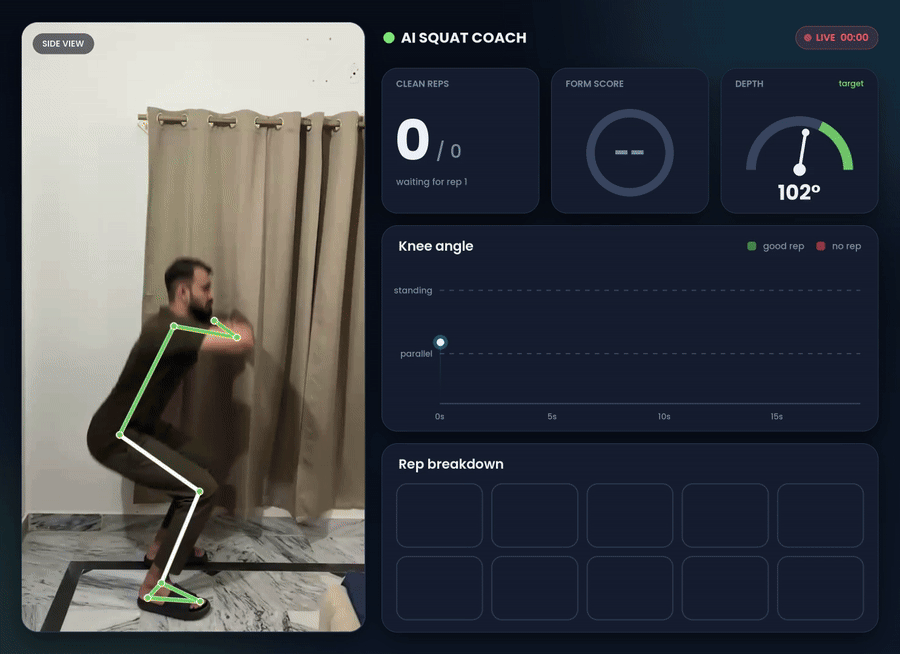
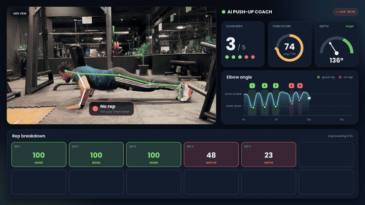

# 🏋️ AI Squat & Push-up Coach

An AI coach that watches a **squat or push-up** video, **counts reps, scores your form, rejects bad reps, and talks you through the set**, then renders everything into a live analytics dashboard.

Runs on a normal laptop CPU. No GPU, no app, just a video.

| Squats | Push-ups |
| --- | --- |
|  |  |

## What it does

- **Counts reps** with a state machine (with hysteresis, so jitter never double-counts)
- **Scores every rep out of 100** on depth, form and tempo
- **Says "no rep"** for half squats, a collapsing chest, lifted heels, or knees caving in
- **Detects the camera view** (side or front) and applies the right rules for each
- **Tracks up to 2 people** at once, each with their own score
- **Voice coach** with natural neural voices: corrections mid-rep ("Chest up!"), rep counts, and a set summary
- **Live dashboard**: knee-angle chart with good/no-rep bands, form-score ring, depth gauge, and a breakdown of every rep

## How it works

```
Video ──► MediaPipe Pose ──► smoothing + near-side selection ──► joint angles
                                                                   │
        dashboard ◄── voice coach ◄── rep scoring + no-rep rules ◄─┘
```

1. **Pose estimation**: [MediaPipe Pose Landmarker](https://ai.google.dev/edge/mediapipe/solutions/vision/pose_landmarker) finds 33 body landmarks per frame.
2. **Clean signals**: landmarks are smoothed, and in side view only the body side facing the camera is used (the hidden side is guessed by the model and unreliable).
3. **View detection**: shoulder width vs. torso length, plus which side is hidden, tells side view from front view.
4. **Measurements**
   - Side view: knee angle (depth), torso lean, heel rise
   - Front view: hip drop (depth) and knee gap vs. ankle gap (knee cave)
   - Both: lowering time (tempo)
5. **Rep logic**: a rep counts when the knee goes below 100° and back above 160°. Each rep is scored and checked against hard "no rep" rules.
6. **Voice**: cues are generated with [edge-tts](https://github.com/rany2/edge-tts), scheduled so they never overlap (corrections beat praise), and mixed into the video with ffmpeg.
7. **Dashboard**: rendered frame by frame with OpenCV + Pillow.

### Scoring

| Side view | Points | Full marks when |
| --- | --- | --- |
| Depth | 35 | knee angle ≤ 90° |
| Torso lean | 25 | chest within 45° of vertical |
| Heels | 15 | heels stay down |
| Tempo | 25 | lowering takes ≥ 1 s |

| Front view | Points | Full marks when |
| --- | --- | --- |
| Depth | 40 | hips drop to knee level |
| Knees | 35 | knee gap ≥ 90% of ankle gap |
| Tempo | 25 | lowering takes ≥ 1 s |

A rep is a **no rep** if it scores below 70, never reaches depth, leans past 60°, lifts the heels clearly, or the knees cave below 75% of the ankle gap. All thresholds are constants at the top of `step3_form_score.py`, so they're easy to tune.

### Push-ups (side view)

| Rule | Points | Full marks when |
| --- | --- | --- |
| Depth | 35 | elbow angle ≤ 90° at the bottom |
| Body line | 30 | hips within 5% of the shoulder–ankle line (no sagging or piking) |
| Tempo | 15 | lowering takes ≥ 0.5 s |
| Lockout | 10 | elbows ≥ 160° at the top |
| Head | 10 | head in line with the body, not dropping to the floor |

A push-up is a **no rep** if the elbow never gets below 100°, the hips are more than 9% off the line, or it scores below 70. Reps only count while you're in a plank (straight legs, body near horizontal), so getting into position or standing up doesn't add reps. Thresholds live at the top of `pushup_form_score.py`.

## Quick start

Python 3.9 to 3.12.

```bash
git clone https://github.com/<your-username>/ai-squat-coach.git
cd ai-squat-coach
pip install -r requirements.txt
python run_coach.py path/to/squat.mp4
```

Your result is `output/<name>_dashboard.mp4`. The pose model and fonts download automatically on the first run, and the voice needs an internet connection.

Options:

```bash
python run_coach.py pushups.mp4 --exercise pushup   # push-ups (film from the side)
python run_coach.py squat.mp4 --people 1            # only track one person
python run_coach.py squat.mp4 --voice en-GB-RyanNeural
python run_coach.py squat.mp4 --no-music            # drop the clip's own sound
python run_coach.py squat.mp4 --no-voice            # silent dashboard
```

### Recording tips

- Camera at **hip height, 2–3 m away**, full body in frame, steady (prop it up)
- **Side view** for depth, back angle and heels. **Front view** for knee cave.
- **Push-ups: always side view**, camera at floor level, whole body from head to feet in frame
- Good light, fitted clothes, and **socks or barefoot**: loose footwear can confuse the heel check

## Project structure

| File | What it does |
| --- | --- |
| `run_coach.py` | Runs the full pipeline on one video |
| `step1_pose_video.py` | Draws the raw pose skeleton (a starting point for learning) |
| `step2_rep_counter.py` | Simple rep counter with a HUD |
| `step3_form_score.py` | Squat form rules, scoring, no-rep detection, view detection |
| `pushup_form_score.py` | Push-up form rules, scoring and no-rep detection (same outputs as Step 3) |
| `step4_voice_coach.py` | Writes and speaks the coaching cues, mixes the audio |
| `step5_dashboard.py` | Renders the analytics dashboard video |
| `pose_utils.py` | Shared helpers: model, smoothing, angles, drawing |

Each step can also be run on its own: `python step3_form_score.py squat.mp4`.

## Limitations

- It works on recorded videos, not live webcam (yet).
- From the side it can't see knees caving in; from the front it can't judge back angle well.
- A rounded back can't be detected from shoulder and hip points alone.
- Thresholds are general defaults. Everyone's squat is a little different, so calibrate them for each person.
- This is form feedback for training, not medical advice.

## Ideas for next steps

Lunges and pull-ups · live webcam mode · per-person calibration · fatigue detection · a learned scoring model

## License

MIT. See [LICENSE](LICENSE).